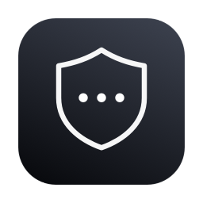
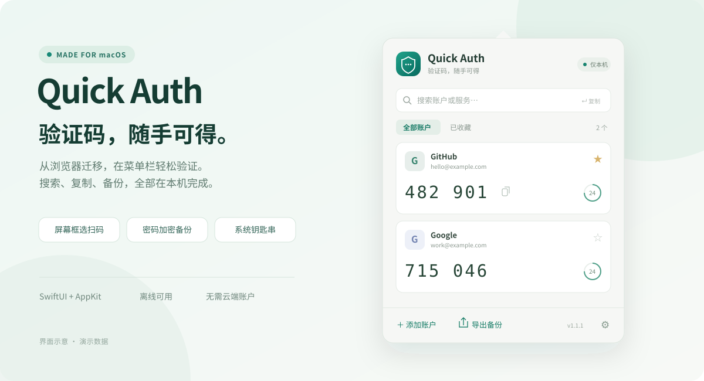

<p align="center">
  
</p>
<h1 align="center">Quick Auth</h1>
<p align="center"><strong>Your codes, one click away.</strong><br>A private authenticator for the macOS menu bar and Windows system tray.</p>
<p align="center"><strong>English</strong> · <a href="README.zh-CN.md">简体中文</a></p>
<p align="center">
  <a href="https://github.com/EvilGenius-dot/quick-auth/releases/latest"></a>
  
  
  
</p>
<p align="center">
  <a href="#download">Download</a> · <a href="#features">Features</a> · <a href="#import-your-accounts">Import</a> · <a href="#back-up-and-move-between-platforms">Backups</a> · <a href="#privacy-and-storage">Privacy</a> · <a href="#development">Development</a>
</p>
<p align="center"><br><sub>Illustrative interface · All accounts and codes shown are fictional</sub></p>

## Download

| Platform | Direct download | Requirements |
| :--- | :--- | :--- |
| **macOS** | **[Download universal DMG](https://github.com/EvilGenius-dot/quick-auth/releases/latest/download/Quick-Auth-macOS-universal.dmg)** | macOS 13+, Apple Silicon or Intel |
| **Windows** | **[Download installer (.exe)](https://github.com/EvilGenius-dot/quick-auth/releases/latest/download/Quick-Auth-Windows-x64.exe)** | Windows 10 / 11, x64 |
| Windows ZIP | [Download standalone folder (.zip)](https://github.com/EvilGenius-dot/quick-auth/releases/latest/download/Quick-Auth-Windows-x64.zip) | Extract the entire folder, then run `Quick Auth.exe` |

[All releases & release notes](https://github.com/EvilGenius-dot/quick-auth/releases) · [SHA-256 checksums](https://github.com/EvilGenius-dot/quick-auth/releases/latest/download/SHA256SUMS.txt)

**Install on Mac:** open the DMG, drag **Quick Auth** into **Applications**, then launch it. Click the shield in the menu bar; no Dock icon is shown.

**Install on Windows:** run the installer, choose English or Chinese, then launch **Quick Auth**. Click the shield in the system tray. Windows may initially place it in the tray’s hidden-icons area. The ZIP edition uses the same local account storage as the installer; it is not a portable vault.

> Release builds are currently **unsigned on Windows** and **ad-hoc signed, without Apple notarization, on macOS**. Windows SmartScreen or macOS Gatekeeper may show a warning. Download from this repository’s Releases and verify the checksum. On macOS, if you trust the download, use **System Settings → Privacy & Security → Open Anyway** when offered. No Developer ID or Windows signing certificate is bundled with this project.

**Updating:** quit the old version before installing. Updating the application preserves local accounts. Keep an encrypted backup for migration and recovery; both apps show their version in the footer.

## Features

| | What you can do |
| :--- | :--- |
| **Always within reach** | Open the menu bar / tray panel, search a service or account, and copy its current code. Countdown indicators show the next refresh. |
| **Four ways to add accounts** | Import a backup, paste an `otpauth://` link, enter a setup key, or scan a QR code from the screen, an image or the clipboard. |
| **Move from Chrome** | Import Authenticator’s plaintext backups and password-protected v1 / v2 / v3 backups. |
| **Back up across platforms** | Export an encrypted backup on Mac and restore it on Windows, or vice versa. Plaintext Authenticator JSON is also available. |
| **English & 简体中文** | Follow the system language or choose a language in Settings. Changes apply immediately. |
| **Made for daily use** | Favorites, search, Enter to copy the first match, launch at login, and a visible **Export backup** button. |
| **On-device storage** | macOS Keychain on Mac; Windows DPAPI protection on Windows. No cloud account, telemetry or synchronization. |

The Mac app remains native **SwiftUI + AppKit**. The Windows app uses **Electron** with an isolated, sandboxed renderer; secret storage, OTP calculation and backup processing stay in the main process or its worker. Both implementations use the same backup format.

## First steps

1. Open Quick Auth from the menu bar or system tray.
2. Click **Add account**, choose an import method, review the preview, then save.
3. Click a code to copy it. Type in the search box and press **Enter** to copy the first match.
4. Click **Export backup** and save a password-protected copy.
5. In **⚙ → Language / 语言**, choose **System default**, **English** or **简体中文**. The Windows tray context menu also includes this setting.

System default uses Simplified Chinese when the preferred system language is Chinese, and English otherwise. Language changes do not alter account labels or backup contents.

## Import your accounts

| Method | Use it for |
| :--- | :--- |
| **Backup file** | Quick Auth encrypted backups or Chrome Authenticator `.json` / `.txt` files. |
| **Paste** | One `otpauth://` link per line, or JSON backup text. |
| **Manual** | A setup key, service name and account supplied by a website or app. |
| **QR code** | A screen selection, a saved QR image, or a screenshot in the clipboard. |

### From Chrome Authenticator

Compatible with [Authenticator (authenticator.cc)](https://authenticator.cc/), Chrome extension ID **`bhghoamapcdpbohphigoooaddinpkbai`**.

1. In the extension, open **Settings → Backup** and download a normal or password-protected backup.
2. In Quick Auth, open **Add account → Backup** and choose the file.
3. Click **Preview accounts**; enter the original backup password if requested. Decryption is local.
4. Review the accounts, then import. Re-imports are deduplicated by secret and OTP parameters.

Existing accounts are preserved; importing an older backup does not rewind an existing HOTP counter. Invalid records are listed explicitly, and partial imports require confirmation. Any encrypted record that fails decryption stops the preview.

Compare your new codes with the original authenticator before removing it. See the [extension’s official export guide](https://authenticator.cc/docs/en/export-and-import.html).

### Manual setup keys

Enter the **setup key**, not a current six-digit code. Unless the service specifies other parameters, use **TOTP · SHA1 · 6 digits · 30 seconds**. Base32 and hexadecimal keys are supported, along with TOTP, HOTP and Steam accounts.

### Screen QR codes

Display the service’s two-factor QR code, then choose **Add account → QR code → Scan screen**. Drag to select the complete QR code and its surrounding whitespace. Press **Esc** to cancel. The result is previewed before saving; ordinary website URLs are never opened.

- **Mac:** uses the system screen-selection tool. The first scan requires permission under **System Settings → Privacy & Security → Screen Recording**. PNG, JPEG, HEIC and TIFF image imports are supported.
- **Windows:** captures the monitor containing the pointer and lets you select the QR region. The screenshot stays in memory. PNG, JPEG, BMP and WebP image imports are supported.
- **Both:** can read a QR screenshot from the clipboard. No camera is used. Standard `otpauth://` QR codes are supported; Google Authenticator’s bulk migration codes are not supported yet.

## Back up and move between platforms

Click **Export backup** at the bottom of the main panel. Export is disabled while locked, when storage cannot be read, or when there are no accounts.

| Format | Intended use | Restore with |
| :--- | :--- | :--- |
| **Password encrypted — default** | Routine backups or migration between Mac and Windows | Quick Auth and the backup password |
| **Plaintext — Authenticator compatible** | Migration back to the Chrome extension or another compatible tool | An Authenticator JSON importer |

Exports include all accounts, algorithms, periods, favorites and HOTP counters. The save dialog starts in Downloads; the destination is yours to choose. Exporting never removes local accounts.

Quick Auth encrypted backups use their own format and cannot be imported directly by the Chrome extension. Forgotten backup passwords cannot be recovered. Plaintext backups contain secrets and require an explicit acknowledgement before export.

<details>
<summary><strong>Encryption and interoperability</strong></summary>

The shared version-1 envelope uses **PBKDF2-HMAC-SHA256** with 600,000 iterations and a random 16-byte salt, then **AES-256-GCM** with a fresh 12-byte nonce. The authenticated context is `QuickAuth backup v1`. Account names, secrets and parameters are encrypted. Wrong passwords and modified ciphertext fail authentication. Importers bound KDF parameters before processing untrusted files.

Files are written to a temporary file in the destination directory and atomically replaced. On macOS the temporary backup has `0600` permissions; Windows access is governed by the destination folder’s ACL. UInt64 HOTP counters are preserved across platforms, including values above JavaScript’s safe integer range.

Implementations: [Swift exporter](Sources/QuickAuthCore/BackupExporter.swift), [Windows core](windows/src/core.cjs). Run `bash scripts/test-interop.sh` to verify a Windows → Mac → Windows encrypted round trip using public test data.

</details>

## Privacy and storage

**No account data is uploaded.** The apps do not implement network requests, analytics or cloud sync. Backups and QR images are never added to the repository by the app.

| Data | Location / behavior |
| :--- | :--- |
| **Mac accounts** | Login Keychain item `local.quickauth.vault / accounts-v1`, with Keychain sync disabled. Search for Quick Auth in Keychain Access. |
| **Windows accounts** | `%APPDATA%\Quick Auth\accounts.vault`, encrypted using Electron safeStorage’s Windows DPAPI provider. The profile may also contain encrypted key-provider metadata and non-secret preferences. |
| Imported files | Read from their original location; not copied into the project. |
| Exported files | Created only through an explicit export, at the path selected in the save dialog. |
| QR captures | Mac: private temporary directory, deleted after completion or cancellation. Windows: in-memory screen image, released after completion or cancellation. |
| Backup passwords | Used for the current operation; not persisted. |
| Clipboard codes | Cleared after 30 seconds if the clipboard still holds the app’s copied content. |

**Mac locking:** locks on screen lock, sleep or user switch; manually lock from Settings. Touch ID or the Mac login password unlocks it. Clipboard entries are marked sensitive and transient for compatible clipboard managers.

**Windows locking:** clears loaded accounts when Windows locks, then reloads after the Windows session is unlocked. **Lock Windows** invokes the system lock. The tray is hidden on suspend. DPAPI protects against other Windows user accounts; it does not isolate secrets from malicious software already running as the same user. Windows Hello authentication inside the app is not implemented.

The Mac login keychain is normally `~/Library/Keychains/login.keychain-db`. Do not manually edit it. To move between computers, use an **encrypted export**; copying the Windows vault alone does not migrate its OS-bound encryption keys.

## Compatibility

| Capability | Support |
| :--- | :--- |
| TOTP / HOTP; SHA1 / SHA256 / SHA512 | Both platforms |
| 6–10 digits and custom periods | Both platforms |
| Steam / Battle.net / hexadecimal account formats | Both platforms |
| Authenticator plaintext and v1 / v2 / v3 encrypted backups | Import on both platforms |
| Quick Auth encrypted JSON | Import and export on both platforms |
| Authenticator plaintext JSON | Export on both platforms |
| Standard `otpauth://` links and QR codes | Both platforms |
| Google Authenticator bulk migration, GOST, cloud sync | Not supported |
| Windows ARM64 / Linux | No dedicated packages in this release |

Backups are limited to **5 MB**, with up to **5,000 accounts** per import/export. QR image files are limited to **20 MB**. The Windows image decoder also limits images to **32 megapixels**.

## FAQ

<details><summary><strong>My codes do not match the service.</strong></summary>

Enable automatic date and time on your computer, then verify the algorithm, digits and period. HOTP does not refresh with time: advance its counter only after using the current code. On Mac, use the account’s context menu; on Windows, use **Next HOTP code**.

</details>

<details><summary><strong>I cannot see Export backup or the language selector.</strong></summary>

Check the version in the footer. Export was added in 1.1.0, a visible export button in 1.1.1, and language selection in 1.2.0. Quit older running copies before opening the newly installed app.

</details>

<details><summary><strong>Will an update delete my accounts?</strong></summary>

Replacing the app does not delete the Keychain entry or Windows profile. A changed macOS signature can cause another Keychain access prompt. The Windows installer preserves application data during uninstall. Keep your own encrypted backup for recovery.

</details>

## Development

### macOS

Requires macOS 13+ and Xcode / Swift 5.9+. Swift dependencies are vendored; no online Swift package download is needed.

```bash
git clone https://github.com/EvilGenius-dot/quick-auth.git
cd quick-auth
bash scripts/swift.sh test
bash scripts/build-app.sh
open "dist/Quick Auth.app"

# Universal (arm64 + x86_64) DMG; requires full Xcode
bash scripts/build-dmg.sh

# Public demo accounts; does not load or save your real accounts
open -n "dist/Quick Auth.app" --args --demo
```

`QUICKAUTH_APP_OUTPUT` changes the `.app` output location. `QUICKAUTH_SIGNING_IDENTITY` selects a signing identity; the default is ad-hoc. `QUICKAUTH_TEST_KEYCHAIN=1 bash scripts/swift.sh test` also runs the isolated Keychain round-trip test. Vision and Keychain tests need access to their macOS system services.

### Windows

Requires Node.js 24 and npm. Build installers on Windows:

```powershell
cd windows
npm ci
npm test
npm start
npm run dist
```

Outputs are in `dist/windows/`. `npm run demo` uses public accounts in a temporary profile. `npm run smoke` exercises the renderer, language switching, search, manual import and export form; on Windows it also verifies actual DPAPI storage and session-lock behavior. **Do not use smoke-test mode for real accounts.**

### Checks and releases

GitHub Actions runs Swift and Node tests, cross-language encrypted backup interoperability, Windows UI/DPAPI smoke checks, universal DMG creation and Windows installer/ZIP packaging. It smoke-tests the packaged Windows executable, too. Push a `v*` tag to publish artifacts and SHA-256 checksums after both platform jobs succeed. Update [release notes](docs/RELEASE_NOTES.md) and both app versions before tagging.

Algorithm coverage includes RFC 4226 / 6238 vectors, strict Base32 decoding, period boundaries, legacy Chrome backups, wrong passwords, ciphertext tampering, unsafe KDF parameters, UInt64 counters, deduplication and failed-write preservation. Screen-selection permissions and multi-monitor interaction should also be checked on real hardware.

```text
Sources/QuickAuth/          Native Mac app and screen capture
Sources/QuickAuthCore/      Swift OTP, backups, localization and Keychain
Sources/CArgon2/            Vendored Argon2 for legacy backup compatibility
windows/src/               Windows tray app, renderer and Node core
Tests/QuickAuthCoreTests/   Swift tests and public synthetic backups
windows/test/              Node tests and public QR fixture
scripts/                   Build, DMG and interoperability scripts
.github/workflows/         Cross-platform build and release pipeline
docs/assets/               Public artwork, never personal account screenshots
```

`.gitignore` excludes account backups, screenshots, databases, keys, certificates, build output and dependencies. Only specifically named public fixtures, package manifests and artwork are included. Never force-add personal backup files.

## Release history

| Version | Changes |
| :--- | :--- |
| **1.2.0** | English / Chinese interfaces, Windows tray app, cross-platform encrypted backups, universal DMG, Windows installer and bilingual documentation. |
| **1.1.1** | Visible export button and version number; expanded documentation. |
| **1.1.0** | Encrypted/plaintext export, manual setup keys and screen/image QR import. |
| **1.0.0** | Native menu bar codes, search, Chrome backup import, Keychain and locking. |

[Third-party notices](THIRD_PARTY.md) · [Authenticator backup format](https://authenticator.cc/docs/en/otp-backup-developer.html) · [RFC 6238](https://www.rfc-editor.org/rfc/rfc6238) · [RFC 4226](https://www.rfc-editor.org/rfc/rfc4226)

---
<p align="center">Quick Auth · Close at hand. Kept on your device.<br><a href="https://github.com/EvilGenius-dot/quick-auth/issues">Report an issue</a> · <a href="README.zh-CN.md">阅读中文文档</a></p>
