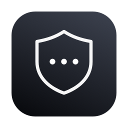
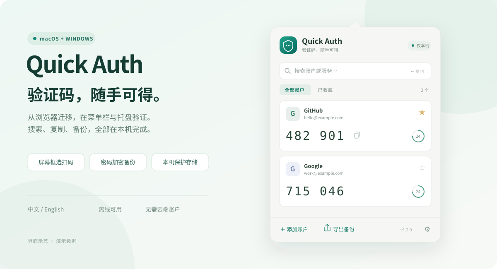

<p align="center"></p>
<h1 align="center">Quick Auth</h1>
<p align="center"><strong>验证码，随手可得。</strong><br>适用于 macOS 菜单栏和 Windows 系统托盘的本机二步验证器。</p>
<p align="center"><a href="README.md">English</a> · <strong>简体中文</strong></p>
<p align="center">
  <a href="https://github.com/EvilGenius-dot/quick-auth/releases/latest"></a>
  
  
  
</p>
<p align="center"><a href="#下载安装">下载安装</a> · <a href="#功能概览">功能概览</a> · <a href="#添加与迁移">添加与迁移</a> · <a href="#导出备份与跨平台迁移">导出备份</a> · <a href="#隐私与存储">隐私与存储</a> · <a href="#开发与验证">开发与验证</a></p>
<p align="center"><br><sub>功能示意图 · 所有账户和验证码均为演示数据</sub></p>

## 下载安装

| 平台 | 直接下载 | 系统要求 |
| :--- | :--- | :--- |
| **macOS** | **[下载通用 DMG](https://github.com/EvilGenius-dot/quick-auth/releases/latest/download/Quick-Auth-macOS-universal.dmg)** | macOS 13+，Apple Silicon / Intel |
| **Windows** | **[下载安装程序（.exe）](https://github.com/EvilGenius-dot/quick-auth/releases/latest/download/Quick-Auth-Windows-x64.exe)** | Windows 10 / 11，x64 |
| Windows ZIP | [下载免安装文件夹（.zip）](https://github.com/EvilGenius-dot/quick-auth/releases/latest/download/Quick-Auth-Windows-x64.zip) | 完整解压后运行 `Quick Auth.exe` |

[全部版本与发布说明](https://github.com/EvilGenius-dot/quick-auth/releases) · [SHA-256 校验值](https://github.com/EvilGenius-dot/quick-auth/releases/latest/download/SHA256SUMS.txt)

**Mac：** 打开 DMG，将 **Quick Auth** 拖入 **Applications（应用程序）**，然后启动。点击顶部菜单栏的盾牌图标；应用不显示 Dock 图标。

**Windows：** 运行安装程序，选择中文或英文后安装。启动后点击系统托盘的盾牌图标；首次可能收纳在「隐藏的图标」中。ZIP 版与安装版使用同一账户目录，账户库并不是可以随 U 盘复制的便携保险库。

> 当前 Windows 包**未进行代码签名**，macOS 包使用**临时签名，未进行 Apple 公证**。系统可能显示 SmartScreen / Gatekeeper 提示。请从本仓库 Releases 下载并核对校验值。在确认来源可信的前提下，macOS 可使用「系统设置 → 隐私与安全性 → 仍要打开」（如系统提供此选项）。项目不包含 Developer ID 或 Windows 签名证书。

**更新：** 先退出旧版，再安装新版。替换应用会保留本机账户；请另外保存加密备份用于迁移和恢复。主面板底部显示当前版本。

## 功能概览

黑色毛玻璃界面搭配银白强调色、细边框账户卡片和清晰的等宽验证码。macOS 使用原生毛玻璃；Windows 11 22H2 及以上使用 Acrylic，旧系统或开启降低透明度时使用纯深色背景。

| | 你可以做什么 |
| :--- | :--- |
| **菜单栏 / 托盘随手用** | 点击图标，搜索服务或账号，复制当前验证码；每个账户都有刷新倒计时。 |
| **四种方式添加** | 导入备份、粘贴账户链接、填写设置密钥，或识别屏幕选区、图片和剪贴板中的二维码。 |
| **从 Chrome 迁移** | 兼容 Authenticator「身份验证器」普通备份，以及 v1 / v2 / v3 密码保护备份。 |
| **跨平台加密备份** | Mac 导出的加密备份可以在 Windows 恢复，反之亦然；也支持兼容插件的明文 JSON。 |
| **中文 / English** | 默认跟随系统，也可在设置中手动切换，立即生效。 |
| **日常操作方便** | 收藏、搜索、回车复制首项、登录时启动，主面板直接显示「导出备份」。 |
| **本机保管** | Mac 使用系统钥匙串，Windows 使用 DPAPI 保护；无需云端账户，无遥测或自动同步。 |

Mac 版继续使用原生 **SwiftUI + AppKit**。Windows 版使用 **Electron**，界面运行在隔离沙箱中，密钥存储、验证码计算和备份处理位于主进程或工作线程。两端保持备份格式兼容。

## 第一次使用

1. 从菜单栏或系统托盘打开 Quick Auth。
2. 点击 **添加账户**，选择导入方式，检查预览并保存。
3. 点击验证码复制；在搜索框输入关键词，按 **回车**复制首个结果。
4. 点击 **导出备份**，保存一份密码保护备份。
5. 在 **⚙ → 语言 / Language** 中选择 **跟随系统、English 或简体中文**。Windows 托盘右键菜单也提供语言切换。

跟随系统时，首选系统语言为中文则使用简体中文，其他语言使用英文。切换语言不会修改账户名称或备份内容。

## 添加与迁移

| 方式 | 适用场景 |
| :--- | :--- |
| **备份文件** | Quick Auth 加密备份，或 Chrome Authenticator 导出的 `.json` / `.txt`。 |
| **粘贴链接** | 每行一个 `otpauth://` 链接，也可粘贴 JSON 备份。 |
| **手动输入** | 网站或 App 提供的设置密钥、服务名和账号。 |
| **二维码** | 屏幕框选、二维码图片、剪贴板截图。 |

### 从 Chrome「身份验证器」迁移

适配 [Authenticator（authenticator.cc）](https://authenticator.cc/)，扩展 ID：**`bhghoamapcdpbohphigoooaddinpkbai`**。

1. 在插件中打开 **设置 → 备份**，下载普通备份或密码保护备份。
2. 在 Quick Auth 中选择 **添加账户 → 备份文件**，打开文件。
3. 点击 **预览账户**；如提示加密，输入导出时的备份密码，解密在本机完成。
4. 检查账户列表后导入。相同密钥和验证码参数会自动去重。

现有账户会保留，重复导入不会回退 HOTP 计数器。无法识别的记录会明确列出，部分导入需要勾选跳过无效记录；任何加密记录解密失败都会终止预览。

迁移后请对照原插件检查验证码，确认成功前保留原插件和备份。参见 [插件官方导出说明](https://authenticator.cc/docs/en/export-and-import.html)。

### 手动输入第三方密钥

填写服务提供的 **设置密钥**，不是当前显示的六位验证码。默认使用 **TOTP · SHA1 · 6 位 · 30 秒**；服务指定了其他参数时再修改。支持 Base32、十六进制密钥，以及 TOTP、HOTP 和 Steam 账户。

### 屏幕二维码

先显示服务提供的二步验证二维码，再选择 **添加账户 → 二维码 → 屏幕扫码**，拖动选框包含完整二维码及周围留白。按 **Esc** 取消。识别后先预览，再保存；普通网址不会被打开。

- **Mac：** 使用系统截图选框。首次需要在「系统设置 → 隐私与安全性 → 屏幕录制」授权。支持 PNG、JPEG、HEIC、TIFF 图片。
- **Windows：** 捕获鼠标所在显示器并提供选框，截图只在内存中处理。支持 PNG、JPEG、BMP、WebP 图片。
- **两端：** 均可粘贴剪贴板中的截图，**不使用摄像头**。支持标准 `otpauth://` 二维码，暂不支持 Google 验证器批量迁移二维码。

## 导出备份与跨平台迁移

点击主面板底部的 **导出备份**。账户为空、应用锁定或存储读取失败时，按钮不可用。

| 格式 | 用途 | 恢复方式 |
| :--- | :--- | :--- |
| **密码加密 · 默认** | 日常备份，Mac 与 Windows 之间迁移 | 使用任一平台的 Quick Auth 导入，并输入密码。 |
| **明文 · 兼容 Authenticator** | 迁移回 Chrome 插件或其他兼容工具 | 使用 Authenticator JSON 导入器。 |

导出包括全部账户、算法、周期、收藏状态和 HOTP 计数器，不会移除本机账户。保存对话框默认指向「下载」，最终位置由你选择。

Quick Auth 加密备份是自有格式，不能直接导回 Chrome 插件；密码遗失后无法恢复。明文文件包含全部密钥，需要明确勾选确认才可导出。

<details>
<summary><strong>加密与跨平台兼容细节</strong></summary>

两端共同使用版本 1 的备份格式：PBKDF2-HMAC-SHA256（600,000 次迭代、随机 16 字节盐）派生密钥，AES-256-GCM 加密，随机 12 字节 nonce，认证上下文为 `QuickAuth backup v1`。名称、密钥与参数都在密文中；密码错误或密文篡改会导致认证失败。导入前会限制不可信 KDF 参数。

备份先写入目标目录的临时文件，再原子替换。Mac 临时文件权限为 `0600`；Windows 访问权限由目标目录 ACL 管理。HOTP 的完整 UInt64 计数器可跨平台保留，包括超过 JavaScript 安全整数范围的值。

见 [Swift 导出实现](Sources/QuickAuthCore/BackupExporter.swift)、[Windows 核心实现](windows/src/core.cjs)。运行 `bash scripts/test-interop.sh` 可使用公开测试数据验证 Windows → Mac → Windows 加密备份互通。

</details>

## 隐私与存储

**账户数据不会上传。** 应用未实现联网请求、遥测或云同步，也不会自动将备份和二维码图片加入仓库。

| 数据 | 保存位置与行为 |
| :--- | :--- |
| **Mac 账户** | 登录钥匙串条目 `local.quickauth.vault / accounts-v1`，不启用钥匙串同步。在「钥匙串访问」搜索 Quick Auth 可找到。 |
| **Windows 账户** | `%APPDATA%\Quick Auth\accounts.vault`，通过 Electron safeStorage 的 Windows DPAPI 提供器加密。配置目录还可能包含加密密钥提供器元数据及非敏感设置。 |
| 原始导入文件 | 保留原位置，只读取，不复制进项目。 |
| 导出的备份 | 仅在主动导出时创建，保存位置由你选择。 |
| 扫码截图 | Mac 使用私有临时目录，完成或取消后删除；Windows 只在内存处理，完成或取消后释放。 |
| 备份密码 | 仅用于本次操作，不持久保存。 |
| 剪贴板验证码 | 30 秒后清除，但只清除仍属于本次复制内容的剪贴板。 |

**Mac 锁定：** 锁屏、休眠、切换用户时自动锁定，也可在设置中手动锁定。使用 Touch ID 或 Mac 登录密码解锁。剪贴板设置敏感和临时标记，是否被第三方剪贴板工具遵守取决于其实现。

**Windows 锁定：** Windows 锁屏时清除内存中的账户，系统解锁后重新加载。「锁定 Windows」使用系统锁屏；休眠时隐藏面板。DPAPI 保护其他 Windows 用户无法读取账户，但不能隔离已经以同一用户身份运行的恶意软件。目前未实现应用内 Windows Hello 解锁。

Mac 登录钥匙串通常位于 `~/Library/Keychains/login.keychain-db`，由系统管理，请勿手动编辑。跨电脑迁移请使用 **加密导出**；单独复制 Windows 的账户文件不能迁移其绑定系统的加密密钥。

## 兼容范围

| 能力 | 支持情况 |
| :--- | :--- |
| TOTP / HOTP，SHA1 / SHA256 / SHA512 | 双平台支持 |
| 6–10 位数字、自定义周期 | 双平台支持 |
| Steam / Battle.net / 十六进制账户格式 | 双平台支持 |
| Authenticator 普通备份、v1 / v2 / v3 加密备份 | 双平台导入 |
| Quick Auth 加密 JSON | 双平台导入和导出 |
| Authenticator 明文 JSON | 双平台导出 |
| 标准 `otpauth://` 链接和二维码 | 双平台支持 |
| Google 批量迁移、GOST、云同步 | 暂不支持 |
| Windows ARM64 / Linux | 此版本不提供专用安装包 |

备份上限 **5 MB**，单次导入或导出最多 **5000 个账户**。二维码图片文件上限 **20 MB**，Windows 图片解码还限制为 **3200 万像素**。

## 常见问题

<details><summary><strong>验证码与服务端不一致怎么办？</strong></summary>

先启用电脑自动设置日期与时间，再检查算法、位数和周期。HOTP 不随时间刷新，只应在当前验证码使用后推进计数器。Mac 通过账户右键菜单，Windows 通过「下一个 HOTP 验证码」操作。

</details>

<details><summary><strong>为什么看不到导出备份或语言切换？</strong></summary>

检查底部版本号：1.1.0 增加导出，1.1.1 在主面板增加独立导出按钮，1.2.0 增加语言切换。退出旧进程后重新启动新安装的版本，避免打开了旧副本。

</details>

<details><summary><strong>更新应用会丢失账户吗？</strong></summary>

替换应用不会删除钥匙串条目或 Windows 配置目录。Mac 签名变化时可能重新询问钥匙串权限；Windows 安装程序在卸载时保留应用数据。请另外保管一份加密备份。

</details>

## 开发与验证

### macOS

需要 macOS 13+ 和 Xcode / Swift 5.9+。Swift 依赖已随仓库提供，无需下载在线 Swift 包。

```bash
git clone https://github.com/EvilGenius-dot/quick-auth.git
cd quick-auth
bash scripts/swift.sh test
bash scripts/build-app.sh
open "dist/Quick Auth.app"

# Apple Silicon + Intel 通用 DMG，需要完整 Xcode
bash scripts/build-dmg.sh

# 演示模式：不读取或保存真实账户
open -n "dist/Quick Auth.app" --args --demo
```

可用 `QUICKAUTH_APP_OUTPUT` 指定应用路径，`QUICKAUTH_SIGNING_IDENTITY` 指定签名身份（默认临时签名）。运行 `QUICKAUTH_TEST_KEYCHAIN=1 bash scripts/swift.sh test` 可增加隔离的钥匙串读写测试。Vision 和钥匙串测试需要访问对应系统服务。

### Windows

需要 Node.js 24 和 npm。在 Windows 上构建安装包：

```powershell
cd windows
npm ci
npm test
npm start
npm run dist
```

输出位于 `dist/windows/`。`npm run demo` 在临时配置目录使用虚构账户；`npm run smoke` 验证隔离界面、中英文切换、搜索、手动导入和导出窗口，在 Windows 还会验证实际 DPAPI 读写及锁屏状态。**不要在 smoke-test 模式中添加真实账户。**

### 自动化与发布

GitHub Actions 执行 Swift / Node 测试、两端加密备份互通、Windows 界面与 DPAPI 检查、通用 DMG 和 Windows EXE / ZIP 构建，并验证打包后的 Windows 程序。两个平台均成功后，推送 `v*` 标签会发布安装包和 SHA-256 校验值。打标签前需更新 [发布说明](docs/RELEASE_NOTES.md) 和两端版本。

测试覆盖 RFC 4226 / 6238、Base32、时间边界、三代插件备份、错误密码、密文篡改、KDF 参数限制、UInt64 计数器、去重及写入失败保护。屏幕权限、框选和多显示器交互还应在实际设备上验证。

```text
Sources/QuickAuth/          原生 Mac 应用和屏幕扫码
Sources/QuickAuthCore/      Swift OTP、备份、多语言、钥匙串
Sources/CArgon2/            旧备份兼容所需的 Argon2
windows/src/               Windows 托盘应用、界面和 Node 核心
Tests/QuickAuthCoreTests/   Swift 测试与公开测试备份
windows/test/              Node 测试与公开测试二维码
scripts/                   构建、DMG、跨平台互通脚本
.github/workflows/         双平台构建与发布流水线
docs/assets/               公开插图，不含真实账户截图
```

`.gitignore` 排除了备份、截图、数据库、密钥、证书、构建产物和依赖。仅明确列出的公开测试样本、包清单及应用图像例外；不要强制提交个人备份文件。

## 版本记录

| 版本 | 变化 |
| :--- | :--- |
| **1.2.1** | 黑色毛玻璃主题、单色卡片和控件、原生毛玻璃 / Acrylic，以及更新的应用图标和预览图。 |
| **1.2.0** | 中英文界面、Windows 托盘客户端、跨平台加密备份、通用 DMG、Windows 安装程序和双语文档。 |
| **1.1.1** | 主面板导出按钮、版本号和完整使用文档。 |
| **1.1.0** | 加密与明文导出、手动密钥、屏幕与图片二维码导入。 |
| **1.0.0** | 原生菜单栏验证码、搜索、Chrome 导入、钥匙串与锁定。 |

[第三方代码说明](THIRD_PARTY.md) · [Authenticator 备份格式](https://authenticator.cc/docs/en/otp-backup-developer.html) · [RFC 6238](https://www.rfc-editor.org/rfc/rfc6238) · [RFC 4226](https://www.rfc-editor.org/rfc/rfc4226)

---
<p align="center">Quick Auth · 随手可得，留在本机。<br><a href="https://github.com/EvilGenius-dot/quick-auth/issues">反馈问题</a> · <a href="README.md">Read in English</a></p>
